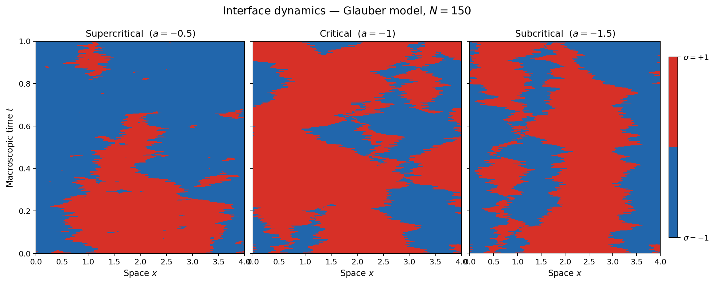

# Glauber interfaces, parametrized by (N, annihilation, creation)

This repository simulates the **1-dimensional Glauber–Ising dynamics** in its
**interface (particle) picture** and compares the finite-`N` Monte-Carlo
correlators against **exact closed-form theory**. The mathematical conventions
are those of Section 1 of the paper.

---

## 🔹 Pages

For a rendered version of the project documentation, see the [📄 GitHub Pages site](https://alessandrogubbiotti.github.io/Glauber/):

- [The sticky Brownian motion](https://alessandrogubbiotti.github.io/Glauber/sticky.html), the simpler case;
- [The three regimes](https://alessandrogubbiotti.github.io/Glauber/regimes.html) of the Glauber dynamics;
- [The model](https://alessandrogubbiotti.github.io/Glauber/model.html);
- [The Gillespie algorithm](https://alessandrogubbiotti.github.io/Glauber/engine.html);
- [The Pfaffian kernel](https://alessandrogubbiotti.github.io/Glauber/pfaffian.html), and its comparison with the simulation;
- [The programs](https://alessandrogubbiotti.github.io/Glauber/programs.html).

---

## 🔹 Primary parameters

The model is parametrized by a scaling parameter `N` and the two reaction
rates, the **annihilation rate** `ann` and the **creation rate** `create`.
The temperature parameters are *derived*:

```
gamma = (N^2 - nu^2) / (N^2 + nu^2)        beta = log(N/nu) / 2
eta   = (N - nu)     / (N + nu)            p    = nu / (N + nu)
```

On a ring of `l = N*L` bonds, in **code units** (hop rate 1 per direction):

- **Interface motion:** an isolated interface hops left or right with rate `1`
  per direction, **into empty bonds only**.
- **Annihilation:** an adjacent pair of interfaces annihilates with rate `ann`.
- **Creation:** a pair is created on each adjacent **empty** pair of bonds with
  rate `create`.

This is what [`src/interface_state.c`](src/interface_state.c) implements.

---

## 🔹 Reversibility and the intensity `nu`

The Bernoulli(`p`) bond measure is reversible iff

```
create * (1 - p)^2 = ann * p^2     <=>     p = 1 / (1 + sqrt(ann/create)).
```

The rescaled interfaces converge to a Poisson point process of intensity `nu`
iff

```
ann / create = N^2 / nu^2
```

— note the ratio is `N^2 / nu^2`, **not** `nu * N^2`. (If `ann/create = theta*N^2`
the limiting intensity is `theta^(-1/2)`.) For `nu = 1` this gives the dictionary
`e^{2*beta} = N`, `gamma = (N^2-1)/(N^2+1)`, `eta = (N-1)/(N+1)`, `p = 1/(N+1)`,
**replacing** the incorrect `N = e^{2*beta}/(1 - e^{beta})` formula used in
earlier versions of these docs.

---

## 🔹 Rate modes (`config.txt`)

```
N=20
nu=1.0
L=4
rate_mode=glauber        # glauber | scaled | explicit
slowdown_exponent=0.0
```

- **`glauber`** (default): `ann = 1 + gamma`, `create = 1 - gamma`. Then
  `ann + create = 2 = 2*hop_rate`, the condition for the correlation hierarchy
  to **close**, so the analytic formulas are exact. The `annihilation`/`creation`
  keys are ignored.
- **`scaled`**: the `glauber` rates times `pow(N, slowdown_exponent)`. Same
  invariant measure, slower reactions (the `a = -1/2, -1, -3/2` family).
- **`explicit`**: read `annihilation`/`creation` verbatim, print the implied
  `nu` and `gamma`. The legacy `(ann, create) = (2, 2/N^2)` has the right ratio
  but `ann + create = 2 + 2/N^2`, so it is only asymptotically Glauber.

The derived block (`nu, beta, gamma, eta, p_equilibrium, rate_mode, ann, create,
time_scale_formula = 2*N^2`) is written to `configuration.json` and printed in
the run banner.

---

## 🔹 Time dictionary

The engine defines macroscopic time `tau = micro_time / N^2` with hop rate 1 per
direction. The analytic formulas are in **Glauber time** (hop rate 1/2 per
direction), so they must be evaluated at

```
t_formula = 2 * N^2 * tau.
```

---

## 🔹 Building and running

```bash
bash compile_gillespie.sh      # ./Gillespie  (trajectories, statistics)
bash compile_corr2pt.sh        # ./Corr2pt    (finite-N correlators)
bash compile_pfaffian.sh       # ./Pfaffian   (the kernel of the interfaces)

./Corr2pt config.txt 2000 equilibrium   # G_n, H_n  (reversible start)
./Corr2pt config.txt 2000 disordered    # C_n       (quench start)
./Pfaffian --nu 1 --nuprime 3           # the kernel after a quench from nu' to nu
```

`./Corr2pt` writes one tidy file per observable (`corr2pt_multi.txt` for
`G_n`, `iface_corr2pt_multi.txt` for `H_n`, `corr_eqtime_multi.txt` for the
single-time `C_n`) and then calls the theory overlay.

The sticky Brownian motion is a submodule, `Sticky-Brownian-Motion`. Clone with
`git clone --recurse-submodules`, or run `git submodule update --init`.

---

## 🔹 Exact theory and verification

- [`python_scripts/theory_glauber.py`](python_scripts/theory_glauber.py) —
  closed-form correlators on `Z` and on the finite ring, using the
  exponentially scaled Bessel functions `ive` for numerical stability.
- [`python_scripts/plot_theory_vs_mc.py`](python_scripts/plot_theory_vs_mc.py) —
  reads a results directory, overlays theory vs MC for each `T`, and prints a
  `chi^2/dof` per curve.
- [`python_scripts/theory/run_checks.py`](python_scripts/theory/run_checks.py) —
  the fourteen checks listed in [`VERIFICATION.md`](VERIFICATION.md); the exit
  code is 0 if all of them pass.
- [`python_scripts/pfaffian_kernel.py`](python_scripts/pfaffian_kernel.py) —
  the Pfaffian kernel of the interfaces, at one and at several times, on the
  lattice and in the limit, for independent interfaces of intensity `nu'` at
  time 0. Its checks are
  [`python_scripts/theory/pfaffian_kernel_check.py`](python_scripts/theory/pfaffian_kernel_check.py).
- [`python_scripts/plot_pfaffian_comparison.py`](python_scripts/plot_pfaffian_comparison.py) —
  reads the output of `./Pfaffian` and compares the estimated kernel and
  correlation functions with the exact ones on the lattice and with the limit.

```bash
python python_scripts/theory/run_checks.py
```

The docstrings are checked automatically at every push on `main`: every script
must start with a docstring that says what it does. To run the check by hand:
`ruff check` (the rules are in [`ruff.toml`](ruff.toml)).

---

## 🔹 Invariant measure

The invariant measure is a Poisson point process of intensity `nu`: the number
of particles is Poisson and the positions are uniform. Started from it (`./Corr2pt
... equilibrium`), the equal-time correlator stays at `eta^|n|` for all `T`
(stationarity).

---

## 🔹 The three regimes

A trajectory for the annihilation rate of order `N^a`, with `a = -0.5`, `-1`
and `-1.5`, from the same initial configuration. See the
[page](https://alessandrogubbiotti.github.io/Glauber/regimes.html).


