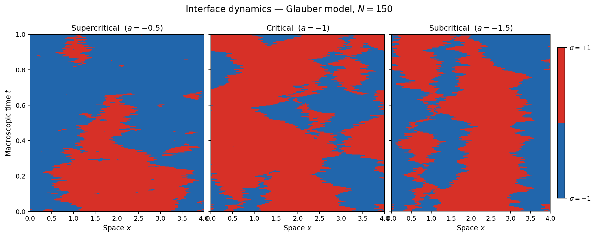

# Glauber Dynamics in the Zero-Temperature Continuum Limit

This repository explores the **zero-temperature continuum limit** of the **1-dimensional Glauber dynamics**.

The Glauber dynamics is a reversible spin dynamics whose invariant measure is the Ising measure. It is better understood in terms of the **interfaces (particles)**: a system of particles performing independent random walks, that annihilate when they meet, with a constant creation rate of pairs of particles. Sites are spaced by $1/N$ and time is **diffusively rescaled**.

The dynamics of the interfaces is simulated with the Gillespie algorithm, and the correlations are compared with the exact formulas.

---

## 🔹 Pages

1. [The sticky Brownian motion](sticky.html): the simpler case, a random walk in $[0,1]$ whose rates at the origin depend on a parameter $a$, and its three scaling limits.
2. [The three regimes](regimes.html): the same three regimes for the interfaces of the Glauber dynamics.
3. [The model](model.html): the rates, the invariant measure, the rate modes, the time dictionary.
4. [The Gillespie algorithm](engine.html): how the dynamics is simulated.
5. [The programs](programs.html): how to compile and run them, the files they write, the scripts, the checks.

---

## 🔹 The Three Regimes

The annihilation rate is of order $N^{a}$ and the creation rate of order $N^{a-2}$. A trajectory for $a = -0.5$, $a = -1$ and $a = -1.5$, from the same initial configuration:

---

## 🔹 Repository

For the source code, visit the [GitHub repository](https://github.com/alessandrogubbiotti/Glauber).
