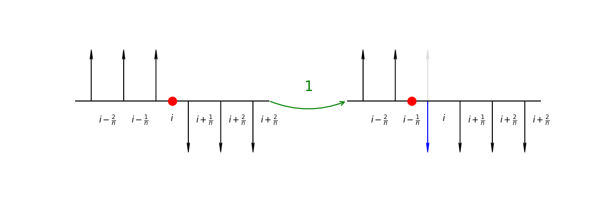
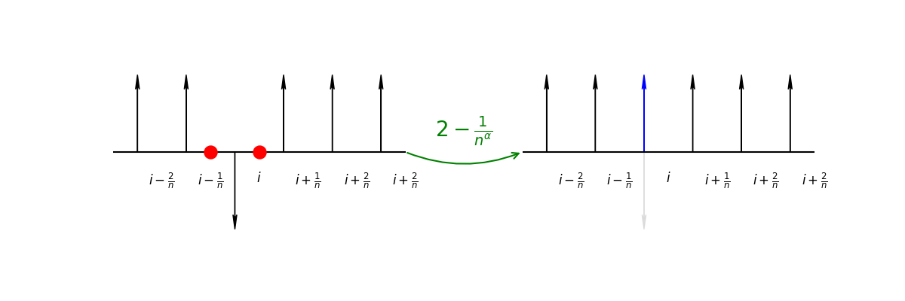
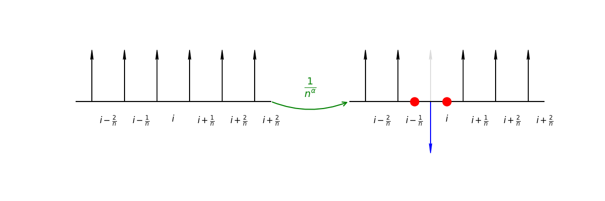

[Back to the index](index.html)

# The Model, parametrized by $(N,\ \mathrm{ann},\ \mathrm{create})$

The dynamics is described in terms of **interfaces (particles)**: a particle sits on a bond between two spins of opposite sign. The mathematical conventions are those of Section 1 of the paper and are summarised below.

---

## 🔹 Description of the Dynamics

The model is parametrized by a scaling parameter $N\in\mathbb N$ and the two reaction rates, the **annihilation rate** $\mathrm{ann}$ and the **creation rate** $\mathrm{create}$. Everything else — $\beta$, $\gamma$, $\eta$, the equilibrium density $p$ — is *derived* from them.

On a ring of $\ell = N L$ bonds, in **code units** (hop rate $1$ per direction):

- **Single interface motion:** an isolated interface moves to the right or to the left with rate $1$ per direction, into an **empty** bond only.

  

- **Annihilation of neighbouring particles:** two neighbouring particles are annihilated with rate $\mathrm{ann}$.

  

- **Creation of particles:** a pair of particles is created on two neighbouring **empty** bonds with rate $\mathrm{create}$.

  

In the pictures the rates are written for the Glauber dynamics with creation rate $n^{-\alpha}$: the annihilation rate is then $2 - n^{-\alpha}$.

This is what [`src/interface_state.c`](https://github.com/alessandrogubbiotti/Glauber/blob/main/src/interface_state.c) implements, see [the Gillespie algorithm](engine.html).

---

## 🔹 Reversibility and the intensity $\nu$

The Bernoulli($p$) bond measure is **reversible** iff

$$
\mathrm{create}\,(1-p)^2 = \mathrm{ann}\,p^2
\qquad\Longleftrightarrow\qquad
p = \frac{1}{1+\sqrt{\mathrm{ann}/\mathrm{create}}}.
$$

Rescaling space by $1/N$, the interfaces converge to a **Poisson point process of intensity $\nu$** iff

$$
\frac{\mathrm{ann}}{\mathrm{create}} = \frac{N^2}{\nu^2}.
$$

> ⚠️ The ratio is $N^2/\nu^2$, **not** $\nu N^2$. If $\mathrm{ann}/\mathrm{create}=\vartheta N^2$
> then the limiting intensity is $\vartheta^{-1/2}$, not $\vartheta$. The legacy
> default $(\mathrm{ann},\mathrm{create})=(2,\,2/N^2)$ has the right ratio $N^2$
> but is reversible for $\nu=1$ only asymptotically (see below).

On the ring the number of interfaces is even: the invariant measure is the Bernoulli($p$) bond measure conditioned to have an even number of particles.

---

## 🔹 Derived quantities

$$
\gamma = \frac{N^2-\nu^2}{N^2+\nu^2},\qquad
\beta = \tfrac12\log\frac{N}{\nu},\qquad
\eta = \frac{N-\nu}{N+\nu},\qquad
p = \frac{\nu}{N+\nu}.
$$

The three `rate_mode`s of `config.txt`:

- **`glauber`** (default) — $\mathrm{ann} = 1+\gamma$, $\mathrm{create} = 1-\gamma$.
  Then $\mathrm{ann}+\mathrm{create}=2=2\times\text{hop rate}$, which is exactly the
  condition for the correlation hierarchy to **close** (so the analytic formulas
  below are exact). Any `annihilation`/`creation` keys are ignored.
- **`scaled`** — the `glauber` rates multiplied by $N^{a}$ (`slowdown_exponent` $a$).
  Same invariant measure, slower reactions; this is the family $a=-\tfrac12,-1,-\tfrac32$
  of [the three regimes](regimes.html).
- **`explicit`** — read `annihilation`/`creation` verbatim and report the implied
  $\nu = N\sqrt{\mathrm{create}/\mathrm{ann}}$ and $\gamma=(\mathrm{ann}-\mathrm{create})/(\mathrm{ann}+\mathrm{create})$.
  The legacy default $(2,\,2/N^2)$ has $\mathrm{ann}+\mathrm{create}=2+2/N^2$, so the
  hierarchy does **not** close and the formulas are only asymptotically Glauber.

---

## 🔹 Time dictionary

The engine advances a microscopic clock and defines macroscopic time
$\tau = \text{micro time}/N^2$ with hop rate $1$ per direction. The analytic
formulas (Glauber / thesis / Henkel) are written in **Glauber time** (hop rate
$1/2$ per direction), so the engine generator is *twice* the Glauber one and the
formulas must be evaluated at

$$
t_{\text{formula}} = 2\,N^2\,\tau_{\text{code}}.
$$

The factor $2N^2$ is written into `configuration.json` as `time_scale_formula`,
so the plotting scripts never hard-code it.

In the macroscopic variables an isolated interface is a random walk of variance $2\tau$.

---

## 🔹 Exact theory and numerical check

[`python_scripts/theory_glauber.py`](https://github.com/alessandrogubbiotti/Glauber/blob/main/python_scripts/theory_glauber.py)
implements the closed-form correlators on $\mathbb Z$ and on the finite ring
(equilibrium correlator $\eta^{|n|}$; two-time spin correlator; single-time
quench correlator; time-delayed interface correlator; exact finite-ring two-time
correlator). [`python_scripts/plot_theory_vs_mc.py`](https://github.com/alessandrogubbiotti/Glauber/blob/main/python_scripts/plot_theory_vs_mc.py)
overlays them on the Monte-Carlo output of `./Corr2pt` and prints a $\chi^2/\text{dof}$
per curve. The fourteen checks listed in `VERIFICATION.md` are run by
`python_scripts/theory/run_checks.py`, see [the programs](programs.html).
