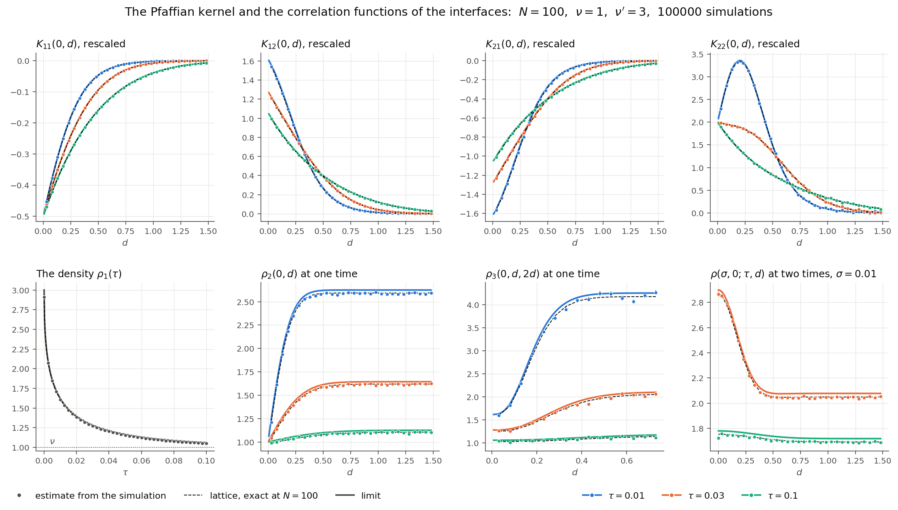

[Back to the index](index.html)

# The Pfaffian Kernel

The interfaces of the Glauber dynamics are, at every time, a **Pfaffian point process**: their correlation functions are Pfaffians of a $2\times2$ block kernel. Garrod proved it, and characterised the kernel through the spin two-point function. Here the kernel is computed, on the lattice and in the limit, and it is compared with the one estimated from the simulation.

The interfaces start independent, one on each bond with probability $$\nu'/(N+\nu')$$, and the dynamics has the `glauber` rates of intensity $\nu$, see [the model](model.html). For $$\nu' = \nu$$ the start is the invariant measure, and for $$\nu' = N$$ the spins are independent.

---

## 🔹 The Correlation Functions

Let $\eta_x$ be the interface on the bond $x$, between the sites $x$ and $x+\tfrac1N$. The **correlation functions** are

$$
\rho(A) = E\prod_{x\in A}\eta_x = P(\text{an interface on every element of }A),
\qquad A \text{ finite}.
$$

For independent interfaces $\rho(A)$ is a product. A point process is **Pfaffian with kernel** $\mathbf K$, a $2\times2$ matrix-valued function with $\mathbf K(y,x) = -\mathbf K(x,y)^{\top}$, if for every $n$ and every $x_1<\dots<x_n$

$$
\rho(\{x_1,\dots,x_n\}) = \mathrm{Pf}\big[\mathbf K(x_i,x_j)\big]_{i,j\le n},
$$

the Pfaffian of the $2n\times2n$ antisymmetric matrix made of the blocks $\mathbf K(x_i,x_j)$.

---

## 🔹 The Kernel on the Lattice

At every time $t$ the interfaces are a Pfaffian point process with kernel, for $x<y$,

$$
\mathbf K^{(t)}(x,y) = -\frac12
\begin{pmatrix} K_t(x,y) & D^+_2K_t(x,y)\\ D^+_1K_t(x,y) & D^+_1D^+_2K_t(x,y)\end{pmatrix},
\qquad
\mathbf K^{(t)}_{12}(x,x) = \tfrac12\big(1-K_t(x,x+\tfrac1N)\big) = E\,\eta_t(x).
$$

Here $D^+_1$ and $D^+_2$ are the forward differences in the first and in the second variable, and $K_t(x,y) = \langle\sigma_x(t)\,\sigma_y(t)\rangle$ is the spin two-point function, the bounded solution of

$$
\partial_tK_t(x,y) = \gamma\,(\Delta_x+\Delta_y)K_t(x,y) - 4(1-\gamma)K_t(x,y)\quad (x<y),
\qquad K_t(x,x) = 1,
\qquad K_0(x,y) = \Big(\frac{N-\nu'}{N+\nu'}\Big)^{N(y-x)}.
$$

The time $t$ is the one of the engine, with hop rate $1$ per direction.

---

## 🔹 The Limit

Sites are spaced by $1/N$ and time is rescaled by $N^2$, $t = N^2\tau$. For every $k$ and $u_1<\dots<u_k$

$$
N^k\,\rho\big(\{\lfloor Nu_1\rfloor/N,\dots,\lfloor Nu_k\rfloor/N\};\,N^2\tau\big)
\longrightarrow \mathrm{Pf}\big[\mathbf K^c(u_i,u_j)\big]_{i,j\le k},
$$

where, for $u<v$,

$$
\mathbf K^c(u,v) = -\frac12
\begin{pmatrix} K^c_\tau(u,v) & \partial_vK^c_\tau(u,v)\\ \partial_uK^c_\tau(u,v) & \partial_u\partial_vK^c_\tau(u,v)\end{pmatrix},
\qquad
\mathbf K^c_{12}(u,u) = -\tfrac12\,\partial_vK^c_\tau(u,u^+) = \rho_1,
$$

and $K^c_\tau$ is the bounded solution of

$$
\partial_\tau K^c_\tau = (\partial_u^2+\partial_v^2)K^c_\tau - 8\nu^2K^c_\tau\quad (u<v),
\qquad K^c_\tau(u,u) = 1,
\qquad K^c_0(u,v) = e^{-2\nu'(v-u)}.
$$

Explicitly $K^c_\tau(u,v) = k_\tau(v-u)$, with

$$
k_\tau(d) = e^{-2\nu d} + e^{-8\nu^2\tau}\Big[\Phi_{2\nu'}(d,2\tau)-\Phi_{2\nu}(d,2\tau)\Big],
\qquad
\Phi_a(d,s) = \tfrac12e^{a^2s}\Big[e^{-ad}\,\mathrm{erfc}\frac{2as-d}{2\sqrt s}-e^{ad}\,\mathrm{erfc}\frac{2as+d}{2\sqrt s}\Big].
$$

- **The density** is $$\rho_1(\tau) = \nu\,\mathrm{erf}\big(2\nu\sqrt{2\tau}\big) + \nu'\,e^{8(\nu'^2-\nu^2)\tau}\,\mathrm{erfc}\big(2\nu'\sqrt{2\tau}\big)$$: it goes from $$\nu'$$ to $\nu$.
- **The two-point function** at one time is $$\rho_2(d) = \rho_1^2 + \tfrac14\big(k_\tau k_\tau'' - (k_\tau')^2\big)(d)$$.
- **For $$\nu' = \nu$$** the dynamics is stationary, $k_\tau(d) = e^{-2\nu d}$ for all $\tau$, and the limit is the Poisson process of intensity $\nu$.

---

## 🔹 Two Times

The same structure holds for several times at once: the correlation functions $E[\eta_{t_1}(x_1)\cdots\eta_{t_n}(x_n)]$ are the Pfaffians of the blocks of an **extended kernel**. In the limit, for $\sigma<\tau$ and $\theta = \tau-\sigma$,

$$
\mathbf K^c_{ij}(\sigma,u;\tau,v) = \big(P^c_\theta\star(\mathbf K^c_\sigma)_{ij}\big)(u,v) - \mathbf 1\{i=1,j=2\}\,P^c_\theta(v-u),
$$

where $P^c_\theta(z) = e^{-4\nu^2\theta}(4\pi\theta)^{-1/2}e^{-z^2/4\theta}$ is the heat kernel killed at rate $4\nu^2$, the convolution $(P^c_\theta\star f)(u,v) = \int P^c_\theta(v-z)f(u,z)\,dz$ is in the second variable, and $\mathbf K^c_\sigma$ is the kernel at the time $\sigma$, extended to all $(u,z)$ by antisymmetry. The blocks with the times exchanged follow from $\mathbf K_{ij}(\tau,v;\sigma,u) = -\mathbf K_{ji}(\sigma,u;\tau,v)$.

---

## 🔹 The Calculator

[`python_scripts/pfaffian_kernel.py`](https://github.com/alessandrogubbiotti/Glauber/blob/main/python_scripts/pfaffian_kernel.py) computes the blocks and their Pfaffians, at one time and at several times, in the limit and on the lattice. From the command line the points are given as `tau,u`:

```bash
python3 python_scripts/pfaffian_kernel.py 0.1,0 0.1,0.3 0.25,0.1 --nu 1 --nu-prime 3 --N 100
```

```
points (tau, u): [(0.1, 0.0), (0.1, 0.3), (0.25, 0.1)]
the kernel of the limit:
[[ 0.        1.060959 -0.257358  0.597681 -0.010602 -0.103487]
 [-1.060959  0.       -0.597681  1.173123 -0.289641  0.055751]
 [ 0.257358  0.597681  0.        1.060959  0.020459 -0.092544]
 [-0.597681 -1.173123 -1.060959  0.       -0.281411 -0.107991]
 [ 0.010602  0.289641 -0.020459  0.281411  0.        1.007101]
 [ 0.103487 -0.055751  0.092544  0.107991 -1.007101  0.      ]]
rho = 1.09981441

the rescaled kernel of the lattice, N = 100, at the bonds [0, 30, 10]:
[[ 0.        1.051079 -0.257346  0.591873 -0.008638 -0.103805]
 [-1.051079  0.       -0.603606  1.173258 -0.289958  0.055772]
 [ 0.257346  0.603606  0.        1.051079  0.022332 -0.092035]
 [-0.591873 -1.173258 -1.051079  0.       -0.280907 -0.10803 ]
 [ 0.008638  0.289958 -0.022332  0.280907  0.        0.997204]
 [ 0.103805 -0.055772  0.092035  0.10803  -0.997204  0.      ]]
N^3 rho^N = 1.067825384
```

On the lattice the blocks are rescaled as

$$
\widehat{\mathbf K}^N = \begin{pmatrix} \mathbf K_{11} & N\,\mathbf K_{12}\\ N\,\mathbf K_{21} & N^2\,\mathbf K_{22}\end{pmatrix},
$$

so that they converge entry by entry to the blocks of the limit, and the Pfaffian of the rescaled matrix is $N^n$ times the correlation function. In Python, from the directory `python_scripts`:

```python
import pfaffian_kernel as pk

pk.density(0.03, nu=1, nu_prime=3)                                  # rho_1 of the limit
pk.correlation([(0.03, 0.0), (0.03, 0.25), (0.03, 0.5)], 1, 3)      # rho_3 of the limit
pk.lattice_correlation([(0.03, 0), (0.03, 25), (0.03, 50)], 100, 1, 3)   # N^3 rho_3^N, N = 100
```

---

## 🔹 The Glauber Scaling

The exact values on the lattice against the limit, for $\nu = 1$ and $$\nu' = 3$$. The difference is of order $1/N$: it halves when $N$ doubles.

- **$\rho_1$ at $\tau = 0.03$.** For $N = 100, 200, 400, 800$: $1.2725$, $1.2774$, $1.2799$, $1.2811$. The limit is $1.2824$.
- **$\rho_2$ at $\tau = 0.03$, at distance $0.25$.** $1.4220$, $1.4344$, $1.4407$, $1.4439$. The limit is $1.4471$.
- **$\rho_3$ at $\tau = 0.03$, at the points $0$, $0.25$, $0.5$.** $1.5848$, $1.6065$, $1.6175$, $1.6231$. The limit is $1.6287$.
- **Three times, the points $(0.01, 0)$, $(0.03, 0.25)$, $(0.1, -0.25)$.** $2.4811$, $2.5078$, $2.5213$, $2.5281$. The limit is $2.5349$.

---

## 🔹 The Comparison with the Simulation

The program `Pfaffian` runs the Gillespie engine from the independent interfaces of intensity $$\nu'$$ and estimates, at the times of `--T`, the four entries of the rescaled kernel. They are expectations of observables of the configuration: for $y = x+r/N$, at the distance of $r\geq1$ bonds,

$$
\widehat{\mathbf K}_{11} = -\tfrac12E[\sigma_x\sigma_y],\qquad
\widehat{\mathbf K}_{12} = N\,E[\sigma_x\sigma_y\,\eta_y],\qquad
\widehat{\mathbf K}_{21} = N\,E[\eta_x\,\sigma_x\sigma_y],\qquad
\widehat{\mathbf K}_{22} = -2N^2E[\eta_x\eta_y\,\sigma_x\sigma_y].
$$

It estimates also the density, the two-point and the three-point functions at one time, by counting the interfaces, the pairs and the triples, and the two-point function at two times. The expectations are averages over the translations and over the simulations, and the distances are grouped in bins of `--bin` bonds.

The four entries are not four independent estimates. With the average over the translations, $$\widehat{\mathbf K}_{12}$$, $$\widehat{\mathbf K}_{21}$$ and $$\widehat{\mathbf K}_{22}$$ are the first and the second differences of the estimate of the spin two-point function, as in the formula of the kernel, and the density is $$-\widehat{\mathbf K}_{21}$$ at the distance of one bond. So the entries and the density test the spin two-point function. The test of the Pfaffian is in $\rho_2$, in $\rho_3$ and in the two-point function at two times, where the pairs and the triples are counted.

The picture is for $N = 100$, $L = 8$, $\nu = 1$, $$\nu' = 3$$, at the times $\tau = 0.01, 0.03, 0.1$, with $100\,000$ simulations. The points are the estimates, with their standard errors. The dashed line is the exact value on the lattice at $N = 100$, averaged over the same bins, and the full line is the limit. In the last panel the first point is the displacement $0$, and the others are averages over a bin and over the two signs of the displacement.



The estimates follow the dashed line, and the distance between the dashed and the full line is the correction of order $1/N$. The $\chi^2$ per point of the estimates against the exact values on the lattice is

- **at $\tau = 0.01$:** $1.42$, $0.84$, $0.85$, $0.96$ for the four entries of the kernel, $1.16$ for $\rho_2$ and $1.11$ for $\rho_3$;
- **at $\tau = 0.03$:** $0.34$, $0.81$, $0.82$, $1.22$ for the four entries, $0.88$ for $\rho_2$ and $0.96$ for $\rho_3$;
- **at $\tau = 0.1$:** $0.50$, $0.79$, $0.75$, $1.15$ for the four entries, $1.02$ for $\rho_2$ and $0.87$ for $\rho_3$;
- **the density:** $1.18$;
- **two times:** $1.21$, $0.95$, $0.87$ for the pairs $(0.01, 0.03)$, $(0.01, 0.1)$, $(0.03, 0.1)$.

There are $30$ bins for each entry of the kernel and for $\rho_2$, $225$ pairs of bins for $\rho_3$, $41$ times for the density and $31$ points for each pair of times. The bins of one observable are estimated on the same simulations, so they are not independent.

The formulas are the ones of the infinite lattice, and the simulation is on a ring of length $L$. At the distance $d$ the difference in the spin two-point function is of the order of $$e^{-2\nu'(L-d)}$$ at the time $0$ and of $e^{-2\nu(L-d)}$ when the dynamics has become stationary, so $L-d$ has to be long with respect to the correlation lengths $1/(2\nu)$ and $$1/(2\nu')$$. Here $L = 8$ and $d\leq1.5$: at large times the difference is $2\cdot10^{-6}$, and at the times of the picture it is below $10^{-12}$.

```bash
bash compile_pfaffian.sh
./Pfaffian --N 100 --L 8 --nu 1 --nuprime 3 --T 0.01,0.03,0.1 \
           --R 1.5 --bin 5 --nsims 100000 --seed 2026 --out pfaffian_mc
python3 python_scripts/plot_pfaffian_comparison.py pfaffian_mc docs/images/pfaffian_comparison.png
```

The options of the program are in [the programs](programs.html).

---

## 🔹 The Checks

```bash
python3 python_scripts/theory/pfaffian_kernel_check.py
```

- **The limit.** $k_\tau$ solves its equation with its data; for $$\nu' = \nu$$ the correlation functions at one time are the ones of the Poisson process; at contact $\rho_2(0^+) = \nu^2$ at every time $\tau > 0$.
- **The formulas already in the repository.** The kernel of the stationary case was already here, in `theory/certify_note_kernel.py` and, in the complex form of the paper, in `theory/cont3_final.py`. For $$\nu' = \nu$$ the calculator gives the same blocks and the same correlation functions, at two and at three times.
- **The lattice.** The two-point function solves its equation; for $$\nu' = N$$ it is `theory_glauber.C_single_disordered`, and for $$\nu' = \nu$$ the two-point function of the interfaces at two times is `theory_glauber.H_interface`.
- **The master equation.** On a ring of $14$ sites the generator of the Glauber dynamics is written explicitly, for all the $2^{14}$ configurations. The correlation functions after the quench, up to four points and three times, are the Pfaffians.
- **The scaling.** The rescaled blocks and $N^3\rho_3^N$ converge to the ones of the limit, with an error that halves when $N$ doubles.
