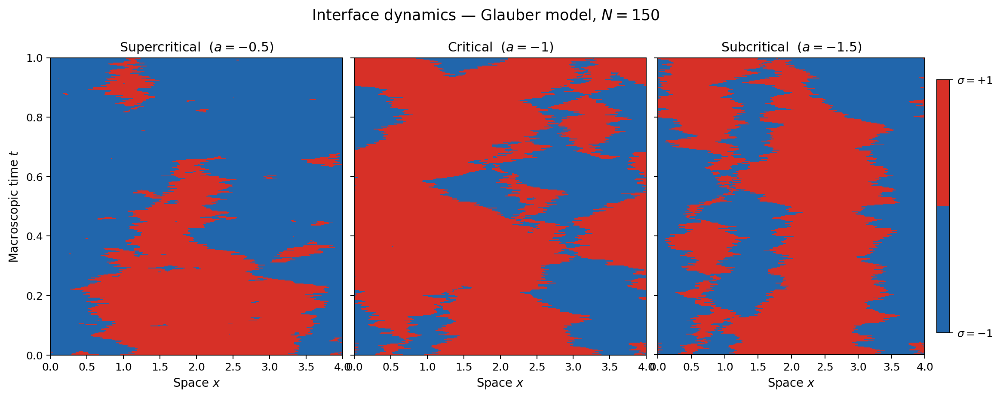
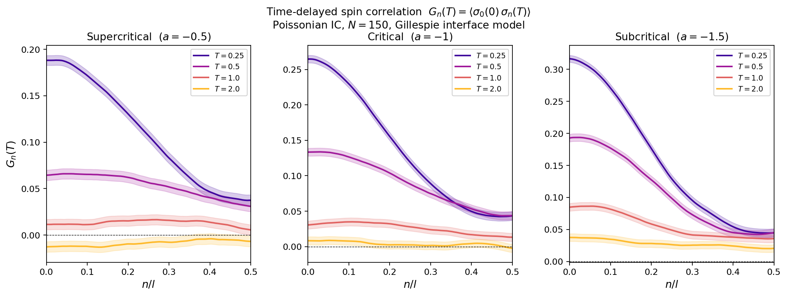

[Back to the index](index.html)

# The Three Regimes

The Glauber dynamics is better understood in terms of the **interfaces (particles)**: a system of particles performing independent random walks, that annihilate when they meet, with a constant creation rate of pairs of particles. Here the rates of the annihilation and of the creation depend on a parameter $a$, as the rates at the origin of [the sticky Brownian motion](sticky.html), and the same three regimes show up.

---

## 🔹 The Rates

Sites are spaced by $1/N$ on a ring of length $L$.

- **Single interface motion:** an interface moves to the right or to the left with rate $1$, provided no other interface is present.
- **Annihilation of neighbouring particles:** two neighbouring particles are annihilated with rate $(1+\gamma)\,N^{a}$.
- **Creation of particles:** at each site, two particles are created with rate $(1-\gamma)\,N^{a}$.

Here $\gamma = (N^2-\nu^2)/(N^2+\nu^2)$, so that $1+\gamma$ is about $2$ and $1-\gamma$ is about $2\nu^2/N^2$: the annihilation rate is of order $N^{a}$ and the creation rate of order $N^{a-2}$. In `config.txt` this is `rate_mode=scaled` with `slowdown_exponent` equal to $a$, see [the model](model.html).

The ratio between the two rates is $N^2/\nu^2$ for every $a$. So the invariant measure does not depend on $a$: in the limit the particles are distributed as the jumps of a Poisson process of intensity $\nu$, conditioned to have an even number of jumps.

---

## 🔹 The Limit

Time is rescaled by $N^2$. Let $S^k$ be the set of the configurations of $k$ interfaces, $x_1 < \dots < x_k$ on the ring, and $u = (u^k)_k$ a function of the configuration, with $u^k$ defined on $S^k$. On the boundary $\partial S^k$ two interfaces are at the same point, and $u^{k-2}$ is there evaluated at the configuration without the two. The formal limit of the Dirichlet form is one of three forms, depending on $a$.

- **Supercritical, $a > -1$: sticky conditions.**

  $$
  \mathcal E(u) = \sum_{k} \int_{S^k} |\nabla u^k|^2\,dx,
  \qquad \mathrm{Tr}(u^k) = u^{k-2}.
  $$

  The interfaces are Brownian particles that annihilate when they meet and nucleate.

- **Critical, $a = -1$: relaxed sticky conditions.**

  $$
  \mathcal E^{\alpha}(u) = \sum_{k} \left\{ \int_{S^k} |\nabla u^k|^2\,dx
  + \alpha \int_{\partial S^k} |\mathrm{Tr}(u^k) - u^{k-2}|^2\,\sigma(dx) \right\}.
  $$

- **Subcritical, $a < -1$: reflecting conditions.**

  $$
  \mathcal F(u) = \sum_{k} \int_{S^k} |\nabla u^k|^2\,dx.
  $$

  The dynamics is simply a combination of independent Brownian motions with reflecting boundary conditions.

In the three cases the limiting dynamics is a set of coupled Brownian motions satisfying the sticky, the relaxed sticky and the reflecting boundary conditions: the three cases of the previous page. On the lattice the boundary term of the Dirichlet form carries the factor $N^{a+1}$.

---

## 🔹 The Simulation

The three pictures are trajectories of `Gillespie` with $N = 150$, $L = 4$ and $\nu = 1$, up to the macroscopic time $1$, for $a = -0.5$, $a = -1$ and $a = -1.5$. The initial configuration is the same in the three runs and has six interfaces. Space is horizontal, time is vertical and the colour is the spin, so the interfaces are the boundaries between the two colours.



During the unit of time the number of interfaces takes the values $0, 2, 4, 6, 8$ for $a = -0.5$, the values $2, 4, 6$ for $a = -1$ and only the values $4$ and $6$ for $a = -1.5$. At $N = 150$ the factor $N^{a+1}$ is $12$, $1$ and $0.08$ in the three cases.

The pictures are obtained with the following `config.txt`, changing `slowdown_exponent`:

```
N=150
nu=1.0
T=1
L=4
rate_mode=scaled
slowdown_exponent=-0.5
resolution=400
N_simulations=1
init_function=1
init_param=0.006667
```

```bash
GILLESPIE_SEED=2026 ./Gillespie      # once for -0.5, once for -1.0, once for -1.5
python3 python_scripts/plot_dynamics.py \
    results_N150_T1.0_L4_Ann0.16_create7.26e-06_gillespie \
    results_N150_T1.0_L4_Ann0.01_create5.93e-07_gillespie \
    results_N150_T1.0_L4_Ann0.00_create4.84e-08_gillespie \
    docs/images/dynamics_comparison.png
```

---

## 🔹 The Correlation in Time

The invariant measure is the same in the three regimes, so the correlations at a single time do not distinguish them. The correlations in time do. The picture shows the time-delayed spin correlation $G_n(T) = \langle \sigma_0(0)\,\sigma_n(T)\rangle$, started from the invariant measure, for $T = 0.25, 0.5, 1, 2$, with $4000$ simulations for each regime.



The correlation of a spin with itself after a time $T$ is $G_0(T)$. For $a = -0.5$, $a = -1$ and $a = -1.5$ it is

- at $T = 0.25$: $0.188$, $0.265$, $0.317$;
- at $T = 0.5$: $0.064$, $0.133$, $0.193$;
- at $T = 1$: $0.011$, $0.030$, $0.085$;
- at $T = 2$: $-0.013$, $0.008$, $0.037$,

with a standard error of about $0.006$. The memory of the initial spin is lost fastest in the supercritical regime and slowest in the subcritical one.

```bash
CORR2PT_SEED=2026 ./Corr2pt config.txt 4000 equilibrium      # once for each value of slowdown_exponent
python3 python_scripts/plot_corr_comparison.py \
    results_N150_nu1.00_L4_equilibrium_Ann0.16_create7.26e-06_corr2pt \
    results_N150_nu1.00_L4_equilibrium_Ann0.01_create5.93e-07_corr2pt \
    results_N150_nu1.00_L4_equilibrium_Ann0.00_create4.84e-08_corr2pt \
    docs/images/corr_comparison.png
```
