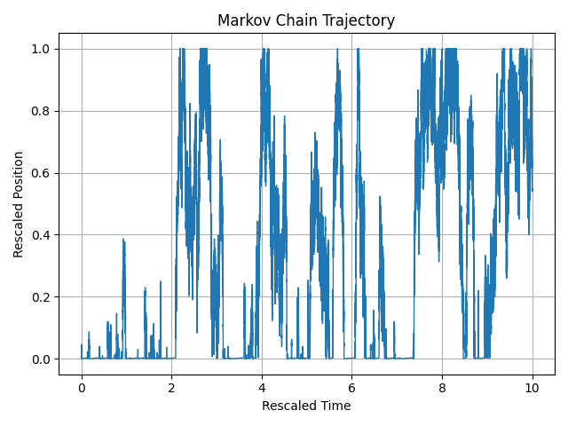
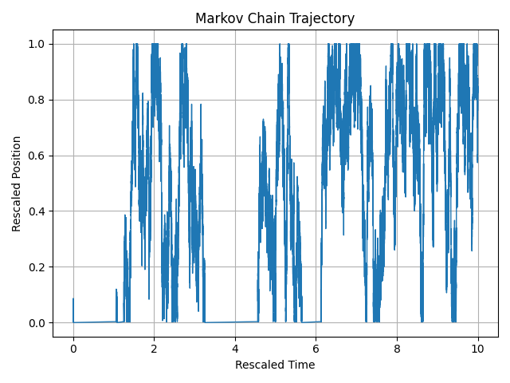
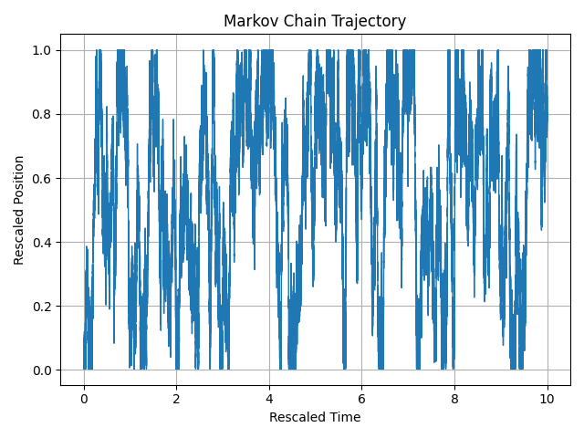

[Back to the index](index.html)

# The Sticky Brownian Motion

This is the simpler case, and we start from it. It is a dynamics in one dimension that possesses all the features of the Glauber dynamics as far as the boundary conditions are concerned. Its code is the repository [Sticky-Brownian-Motion](https://github.com/alessandrogubbiotti/Sticky-Brownian-Motion), which is a submodule of this one.

The repository implements a discrete Markov chain approximation of a Brownian motion in $[0,1]$, with different boundary conditions at $0$. The discrete dynamics depends on a parameter $a$ and, under a diffusive rescaling, for some choice of the parameter, the limiting Brownian motion is a **Sticky Brownian** at $0$. Other boundary behaviours at $0$, depending on $a$, show up.

---

## 🔹 State Space

We consider the discrete state space

$$
\{0, \tfrac{1}{N}, \tfrac{2}{N}, \dots, 1\},
$$

where the chain moves between adjacent points. In the code the states are indexed as integers, $0, 1, \dots, N$, with state $k$ corresponding to $k/N$.

---

## 🔹 Transition Rates

- **Interior states** ($1/N, \dots, 1-1/N$): the jump rates are symmetric with value **1** for moving left or right.

- **Left boundary at 0**:
  - from $0$ to $1/N$: rate $N^{a-1}$;
  - from $1/N$ to $0$: rate $N^{a}$. We refer to $N^a$ as the **annihilation rate**.

- **Right boundary at 1**: from $1$ to $1 - 1/N$ the rate is **1**. This boundary is less interesting, since it behaves like a reflecting boundary.

---

## 🔹 Invariant Measure

The chain is a **birth-death process** and its invariant distribution $\pi$ is given by detailed balance. It is constant on the states $k = 1, \dots, N$ and

$$
\frac{\pi(1)}{\pi(0)} = \frac{N^{a-1}}{N^a} = \frac{1}{N},
$$

so that

$$
\pi(0) = \tfrac{1}{2}, \qquad \pi(k) = \tfrac{1}{2N}, \quad k=1,\dots,N.
$$

The invariant measure does not depend on $a$: half of the mass is at the origin.

---

## 🔹 Scaling Limits

Time is rescaled diffusively, by $N^2$, and we look at the limit $N \to \infty$. Depending on the value of the parameter $a$ there are three different limiting behaviours at the left boundary:

- **Case $a > -1$**: the process converges to **Brownian motion with a sticky boundary condition at 0** and reflecting at 1.

- **Case $a = -1$**: an intermediate regime, where the particle spends an **exponential amount of time at the origin** before resuming Brownian motion.

- **Case $a < -1$**: both boundaries become **reflecting** in the limit.

In the rescaled time the chain leaves the origin at rate $N^{a+1}$. This rate diverges for $a > -1$, it is $1$ for $a = -1$ and it vanishes for $a < -1$.

---

## 🔹 Figures

A sample trajectory for each case, with $N = 300$, up to the rescaled time $10$.

- **Sticky boundary at 0 ($a = -0.5$)**

  

- **Intermediate regime ($a = -1$)**

  

- **Reflecting boundaries ($a = -1.3$)**

  

---

## 🔹 The Program

The chain is simulated with the **Gillespie algorithm**: the time of the next jump is exponential with parameter the sum of the rates out of the current state, and the jump is chosen with probability proportional to its rate. The parameters $N$, $T$, $a$ and the seed are the `#define` at the top of `sticky.c`. The first command is needed if the repository was cloned without `--recurse-submodules`.

```bash
git submodule update --init
cd Sticky-Brownian-Motion
cc sticky.c -o sticky -lm
./sticky                         # writes trajectory.dat: rescaled time, rescaled position
python3 plot.py                  # writes trajectory.png
```

The next page compares the same three regimes for the interfaces of the Glauber dynamics: [the three regimes](regimes.html).
