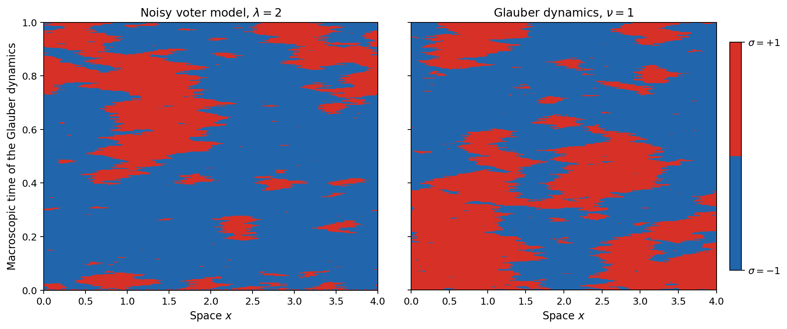

[Back to the index](index.html)

# The Noisy Voter Model

Read as a two-colour voter model, the Glauber dynamics is a **noisy voter model**: the colour of a site is found by following a backward random walk until a mark is met. In the limit the random walks become the Brownian web, and the model is the **Continuum Noisy Voter Model** of [Fontes, Isopi, Newman and Ravishankar](https://arxiv.org/abs/math/0404505). Its code is the repository [Continuum-Noisy-Voter-Model-](https://github.com/alessandrogubbiotti/Continuum-Noisy-Voter-Model-), which is a submodule of this one.

---

## 🔹 The Glauber Dynamics as a Voter Model

The spin at $x$ flips at the rate

$$
w_x(\sigma) = 1-\frac\gamma2\,\sigma_x\big(\sigma_{x-1}+\sigma_{x+1}\big).
$$

This is the rate of a spin that

- **copies a neighbour:** with rate $\gamma$ it takes the value of the spin on its left, and with rate $\gamma$ the value of the one on its right;
- **is marked:** with rate $2(1-\gamma)$ it takes a new value, $+1$ or $-1$ with probability $1/2$.

Indeed, with $n$ neighbours of the opposite sign the spin flips at rate $\gamma n + (1-\gamma)$, which is $1-\gamma$, $1$ and $1+\gamma$ for $n = 0, 1, 2$: the creation, the motion and the annihilation of the interfaces.

So the value of a spin is found by following its **genealogy** backwards in time: a random walk that jumps to each neighbour with rate $\gamma$, until the first mark. The genealogies of two spins are independent until they meet, and then they are the same.

With $\gamma = (N^2-\nu^2)/(N^2+\nu^2)$, in a unit of macroscopic time a genealogy has variance $2\gamma$ and meets the marks at rate $2N^2(1-\gamma)$: in the limit, variance $2$ and rate $4\nu^2$.

---

## 🔹 The Limit

From every point a backward Brownian path starts, of variance $2$ in a unit of macroscopic time, and this path is marked by a Poisson process of rate $4\nu^2$. The colour of a point is the one of the first mark met by its path: this is the **continuum noisy voter model**. From each mark two Brownian paths start, forward in time. When the mark changes the colour, which has probability $1/2$, they are two interfaces. The interfaces annihilate when they meet.

- **At a fixed time**, on the line and for the dynamics started from the invariant measure, the colours are the stationary two-state Markov chain with flip rate $\nu$, whose discontinuities form a Poisson process of intensity $\nu$. On the ring the Poisson process is conditioned to have an even number of points. From independent spins, as in the pictures below, this holds in the limit of a large time.
- **The correlation in time**, also on the line and from the invariant measure, is

  $$
  \lim_{N\to\infty}\langle\sigma_0(0)\,\sigma_{\lfloor Nu\rfloor/N}(N^2\tau)\rangle
  = e^{-4\nu^2\tau}\,E\big[e^{-2\nu|u+W_{2\tau}|}\big],
  \qquad W_{2\tau}\sim\mathcal N(0,2\tau),
  $$

  the probability that the backward paths from $(0,0)$ and $(u,\tau)$ coalesce before either is marked.

---

## 🔹 The Program

`nvm_sim.c` simulates the model in discrete time, on a ring of length $L$ with sites spaced by $1/N$. At each step every site

- **is marked** with probability $\lambda/N^2$, and takes a new colour;
- otherwise **takes the colour** that one of its two neighbours, the left or the right one with probability $1/2$, had at the step before.

A unit of time is $N^2$ steps, so a genealogy has variance $1$ in a unit of time and meets the marks at rate $\lambda$. With $t$ the time of the program and $\tau$ the macroscopic time of the Glauber dynamics, the time is doubled:

$$
\lambda = 2\nu^2, \qquad t = 2\tau.
$$

In the limit, at a large time and on the line, the correlation of the colours of two sites at distance $d$ is $e^{-\sqrt{2\lambda}\,d} = e^{-2\nu d}$, and the interfaces have density $\sqrt{\lambda/2} = \nu$. On the ring of length $L$ the density is $\sqrt{\lambda/2}\tanh(L\sqrt{\lambda/2})$: it is the one of the line when the ring is long.

A genealogy moves by one site at each step, so along it the parity of the site plus the step is constant: the points of the two parities never meet, and they carry two independent copies of the model. The program simulates one of them, and a row has $NL/2$ sites.

The first command is needed if the repository was cloned without `--recurse-submodules`.

```bash
git submodule update --init
cd Continuum-Noisy-Voter-Model
cc nvm_sim.c -o nvm_sim -lgsl -lgslcblas -lm
./nvm_sim                        # writes output.txt and output.pgm
python3 plot.py                  # writes output.png
cd ..
```

With the default parameters the ring has less than one interface on average, so the density that the program prints for one run can be far from the limit next to it: the check below uses a long ring.

The parameters $N$, $L$, $T$, $\lambda$, the number of saved rows in a unit of time and the seed are the `#define` at the top of `nvm_sim.c`, and they can be given at compile time, as below.

---

## 🔹 The Simulation

The two pictures are for $N = 150$, $L = 4$ and $\nu = 1$, from independent spins, up to the macroscopic time $1$ of the Glauber dynamics. On the left the noisy voter model with $\lambda = 2$, up to its time $2$; on the right the Glauber dynamics. They are two samples of two dynamics with the same limit.



```bash
cd Continuum-Noisy-Voter-Model
cc -DN=150 -DL=4 -DT=2 -DLAMBDA=2 -DRESOLUTION=200 -DSEED=2026 nvm_sim.c -o nvm_sim -lgsl -lgslcblas -lm
./nvm_sim
cd ..
GILLESPIE_SEED=2026 ./Gillespie      # with the config.txt below
python3 python_scripts/plot_voter_comparison.py Continuum-Noisy-Voter-Model/output.txt \
    results_N150_T1.0_L4_Ann2.00_create8.89e-05_gillespie docs/images/voter_comparison.png
```

```
N=150
nu=1.0
T=1
L=4
rate_mode=glauber
resolution=400
N_simulations=1
init_function=4
init_param=0.5
```

---

## 🔹 The Check

On the lattice of the program, at a large time and on a long ring, the correlation of the colours of two sites of a row at the distance of $j$ sites is $r^j$, where

$$
r = \frac{(2-s)-2\sqrt{1-s}}{s},\qquad s = \Big(1-\frac{\lambda}{N^2}\Big)^2,
$$

and the density of the interfaces is $N(1-r)/4$. The program prints the density of the interfaces, averaged over the second half of the run, next to its limit.

- **With $N = 100$, $L = 200$, $\lambda = 2$**, up to the time $6$, ten runs give $0.985 \pm 0.007$. On the lattice it is $0.980$, and in the limit $1$. The seed is given at compile time, so the program is compiled once for each seed, from $1$ to $10$.

```bash
cd Continuum-Noisy-Voter-Model
for s in 1 2 3 4 5 6 7 8 9 10; do
    cc -DN=100 -DL=200 -DT=6 -DLAMBDA=2 -DSEED=$s nvm_sim.c -o nvm_sim -lgsl -lgslcblas -lm
    ./nvm_sim
done
```
